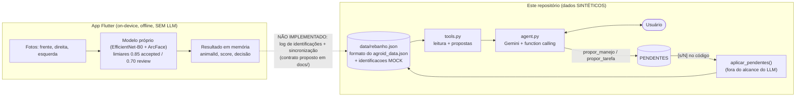

# Nellus: agente de manejo para o rebanho (hackathon)

> **Tudo aqui é SINTÉTICO.** O rebanho, os eventos e as identificações são fictícios.
> O app Flutter da Nellus **não** registra histórico de identificações e **não** está integrado a
> este agente. O campo `identificacoes` do JSON é **mock**.

## Problema

O produtor identifica o animal pela foto no app, mas depois precisa cruzar a identidade com a
sanidade, o peso e o cadastro: quem está com aftosa vencida, qual lote não tem área, quem não tem
ID visual. Hoje isso é manual.

## Solução

Um agente de IA (Python + Gemini com function calling) que consulta os dados do rebanho por
**ferramentas determinísticas**, explica o que encontrou e **propõe** (nunca grava sozinho) ações
de manejo. A gravação só acontece depois de um `[s/N]` feito pelo código, não pelo modelo.

## Arquitetura



O reconhecimento visual **não usa LLM**. O agente atua sobre eventos e dados já registrados.

## Como rodar

```bash
python3 -m venv .venv && source .venv/bin/activate
pip install -r agent/requirements.txt

# opcional: regenera o dataset sintético (o repo já traz data/rebanho.json com NELLUS_HOJE=2026-10-24)
NELLUS_HOJE=2026-10-24 python agent/gerar_dados.py

export GEMINI_API_KEY=...        # só por variável de ambiente; nunca no repositório
python agent/agent.py                              # chat
python agent/agent.py --identificacao ident_001    # processa uma identificação MOCK
```

Variáveis: `GEMINI_MODEL` (padrão `gemini-3.8-flash`; `gemini-2.5-flash` ainda é servido, mas só
para quem já usava a série 2.5), `NELLUS_DATA` (caminho do JSON), `NELLUS_HOJE` (AAAA-MM-DD),
`NELLUS_OUT` (pasta dos dossiês, padrão `out/`).

Perguntas para testar: "Quais animais do Lote 3 estão com aftosa pendente?", "Monte um plano de
ação", "pesei o BR 123 com 432 kg" (gera proposta e pede confirmação), "Gere o dossiê do BR 121".

## Ferramentas (`agent/tools.py`)

| Tool | O que faz |
|---|---|
| `buscar_animais` | Filtra por lote, categoria, texto e ausência de ID visual |
| `historico_animal` | Dados e eventos de um animal |
| `animais_sem_vacina` | Nunca vacinados ou vencidos (validade padrão 180 dias) |
| `ganho_peso_lote` | Ganho de peso por animal e médio na janela de dias |
| `auditar_cadastro` | ID visual, SISBOV e área dos lotes |
| `auditoria_priorizada` | Plano de auditoria ordenado por regras fixas (abaixo) |
| `identificacoes_recentes`, `processar_identificacao` | Identificações MOCK e seus alertas |
| `gerar_dossie` | Markdown em `out/` com linha do tempo, peso e pendências |
| `propor_manejo`, `propor_tarefa` | **Só propõem**; acrescentam a uma lista de pendentes |

`aplicar_pendentes()` grava, mas **não é exposta ao LLM**: só o código a chama após o `[s/N]`.
Brincos são normalizados (ignora espaço e caixa) e o lote casa por substring ("3" = "Lote 3").
Toda tool devolve um dict com mensagem de erro clara e nunca levanta exceção.

## Regras de severidade (calculadas em código)

Ordem: severidade, depois mais dias de atraso. O LLM explica o plano; não reordena nem inventa itens.

| Severidade | Regra |
|---|---|
| CRITICA | Aftosa nunca aplicada, ou vencida (última aplicação há mais de 180 dias) |
| ALTA | Animal ativo sem identificação visual (o app não consegue reconhecê-lo) |
| MEDIA | Lote sem área em hectares (impede o cálculo de lotação UA/ha) |
| BAIXA | SISBOV vazio (um único item agrupado, com contagem e exemplos) |

Dias de atraso: nunca vacinado = dias desde o cadastro; vencida = dias além dos 180.

## Testes e harness

```bash
pytest -q                          # camada A: tools vs dados fixos, offline (sem LLM, sempre verde)
python scripts/verificar_ip.py     # barra ativos proibidos e segredos
python scripts/validar_contrato.py # valida os exemplos do contrato
python scripts/validar_contrato.py --rebanho  # e as identificacoes (mock) de data/rebanho.json
GEMINI_API_KEY=... python eval/harness.py -n 3   # camada B: 15 cenários com Gemini
```

A camada B roda cada cenário N vezes sobre uma **cópia** do JSON (`NELLUS_HOJE=2026-10-24`),
registra as tools chamadas e confere asserções objetivas (IDs citados existem, tools esperadas,
JSON inalterado sem confirmação, ordem de severidade). Erro ou cota da API = *inconclusivo*, não
falha. Gera `eval/relatorio.md`. Sem chave, a camada B é pulada com aviso.
**Estado atual: a camada B ainda não foi executada** (o relatório do repositório é um stub).
Os números dela medem o comportamento do agente em dados sintéticos, **não** a acurácia do modelo
de visão.

## Contrato de identificação (proposto)

[docs/contrato_identificacao.schema.json](docs/contrato_identificacao.schema.json) e
[docs/contrato_identificacao.md](docs/contrato_identificacao.md) separam o que o app produz hoje
(`animalId`, `score`, `decisao`, `modelVersion`) do que é **proposto e não existe** (`timestamp`,
`usuario`, `segundoCandidato`, `scoreSegundo`, `margem`).

## Limitações e o que é sintético

- Todos os dados são sintéticos: 24 animais (BR 101 a BR 124), 3 lotes, eventos gerados por fórmula.
- `identificacoes` é mock. O app não guarda histórico de identificações; a integração app-agente
  **não existe**.
- Nomes de campo foram conferidos contra o código do app (`lib/data.dart`, `lib/store.dart`,
  `lib/vision/cattle_vision_service.dart`); o dataset segue o formato do `agroid_data.json`.
- Sobre o modelo de visão, afirmamos só: EfficientNet-B0 + ArcFace treinado com 12 animais,
  limiares 0.85 (accepted) e 0.70 (review). Este repositório não contém modelo, fotos nem
  métricas dele.
- Sem fotos, sem pesos, sem dados reais. O agente depende de uma chave Gemini e de rede.

## Próximos passos

- Registrar um log de identificações no app, no formato do contrato proposto.
- Sincronizar esse log com o agente.
- Evoluir para um modelo de reconhecimento mais robusto, a partir da pesquisa em andamento.
- Rodar o harness com a chave e acompanhar a taxa de acerto por versão do agente.

## Licença

Proprietária, todos os direitos reservados (ver [LICENSE](LICENSE)).
